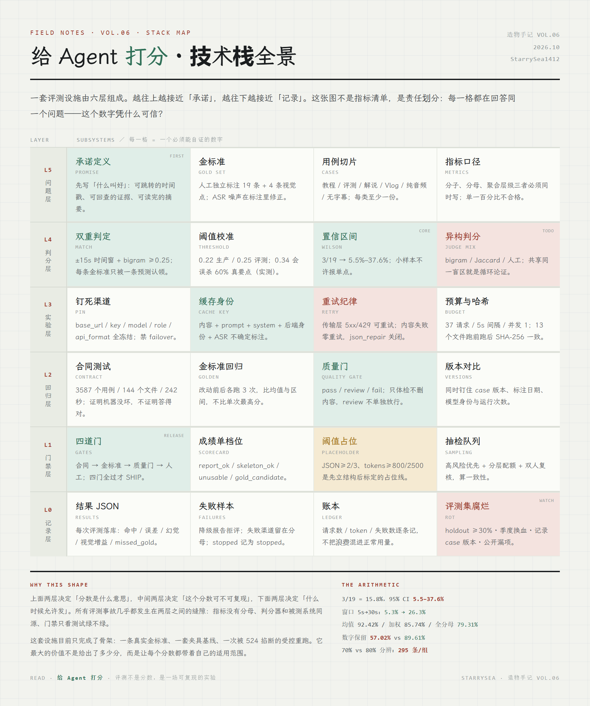

# 给 Agent 打分 · 造物手记 VOL.06

> 评测不是分数，是一场可复现的实验。分数不是一个数，是一个区间。

**[打开这一页 →](https://starrysea1412.github.io/agent-eval/)**



SeeFlow（[源码仓库](https://github.com/StarrySea1412/seeflow)）评测设施的深度解剖。同一份 14 条要点的省流，三种判分器给出 **0/19、3/19、5/19**；同一个 3/19，把时间窗从 5 秒放宽到 30 秒，分数就从 **5.3% 变成 26.3%**。

这篇不教你怎么把分数做好看，而是拆开「分数」本身：金标准怎么独立标注、判分器怎么被校准、小样本的置信区间有多宽、一次只跑了 8 个请求就被掐断的实验为什么仍然有效、以及一份全员通过的体检为什么没有区分度。

## 七章

| # | 章节 | 讲什么 |
|---|---|---|
| 01 | 单次分数是噪声 | Agent 评测为什么比模型评测难；缓存与运行路径；降级报告拒评；确定性夹具测合同不测波动 |
| 02 | 指标的解剖 | 同一基线算出 92.42% / 91.09% / 85.74% / 79.31%；数字保留 57.02% vs 89.61%；四个指标的四种盲区 |
| 03 | 金标准与置信区间 | 19 条人工标注；3/19 的 95% Wilson 区间 5.5%–37.6%；±10% 半宽要 62 条，70 vs 80 要 295 条/组 |
| 04 | 判分器也要被评测 | 逐字 0 / 时间窗 5 / bigram 3 / Jaccard 3；窗口 5s→30s 分数翻五倍；循环论证与 LLM 裁判的偏差 |
| 05 | 实验纪律 | 钉死渠道与缓存键；37 请求 / 5s 间隔 / 并发 1；8 个请求被 524 掐断；内容失败零重试；完整性哈希 |
| 06 | 回归与门禁 | 3587 个合同测试；40 个问答用例的引用合同；四道发布门，缺一不可 |
| 07 | 人的位置 | 87 份成绩单里 86 份一模一样；阈值是占位；抽检、双人复核、被纠正次数、评测集腐烂 |

## 四枚可玩小样

全部是**确定性模型**，不是录屏：

- **置信区间尺**：拖金标准条数与命中数，看 Wilson 区间怎么变；两个系统的区间重叠时，任何「A 比 B 好」的结论都不成立。
- **判分器对照台**：用真实的 19 条金标准与 14 条实际预测，切换逐字 / 时间窗 / bigram / Jaccard，看同一份输出的分数如何变化。
- **重复运行**：真实能力 80% 的系统跑 12 次，单次范围 57.9%–94.7%；看「突然变好」有多少只是抽样运气。
- **发布门禁**：四道门任意开关，只有全 PASS 才 SHIP；合同测试全绿也无法单独放行。

## 技术实现

- `index.html` 单文件承载：零构建、零依赖、原生 JS；图表为手写 SVG / DOM
- 冷色实验纸主题（`--paper #f2f3ee` / 松绿 `#2f6f57` / 赭黄 `#a9761c` / 砖红 `#9c3b2e`），带 28px 网格底纹
- 自托管 LXGW 文楷子集（1036 字形 × 2 字重，各约 220KB）
- 五张插图由 GPT 系图像模型生成
- 验收：本地静态服务 + Playwright 无头逐状态截图（`build/verify.mjs`）、逐屏滚动截图（`build/scroll.mjs`），0 pageerror、0 broken image、移动端 0 横向溢出；发布后 `build/verify-live.mjs` 线上复验

## 构建

```bash
node build/build.mjs        # build/*.html + style.css + data.json + demos.js → index.html
node build/verify.mjs       # 四枚小样逐状态截图 + 错误收集 → shots/
node build/scroll.mjs       # 逐屏截图（发现真实空白）→ shots/scroll/
node build/render-stack.mjs # docs/tech-stack.html → assets/tech-stack.png
```

## 数字出处

所有数字都可在 SeeFlow 仓库核对：

- `eval/cases/yingshi-2025-awards/` — 19 条金标准 + 4 条视觉点；`work/f1b818c4/省流.md` — 14 条真实预测（0/3/5 三个判分结果由此复算）
- `eval/results/quality-baseline-20260930-201221.json` — 12 份材料 / 120 条断言：92.42%、85.74%、79.31%、91.09%、57.02%、89.61%
- `eval/results/qa-check-20260922-071356.json` — 40 个问答用例：引用 100%、拒答 100%、编造引用 2/2 丢弃
- `eval/results/xiaobai-…/requests.json` — 受控重跑：8 个物理请求、19,829 token、HTTP 524 停止
- `work/_scorecards/` — 87 份模型成绩单：86 份同渠道同模型、指标完全一致
